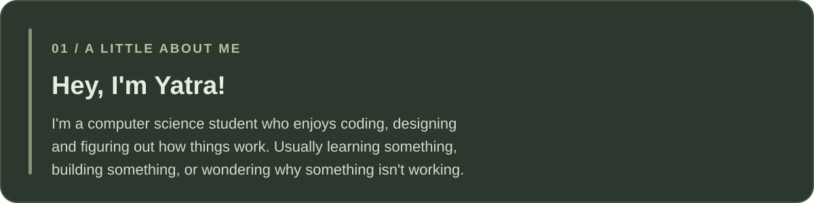
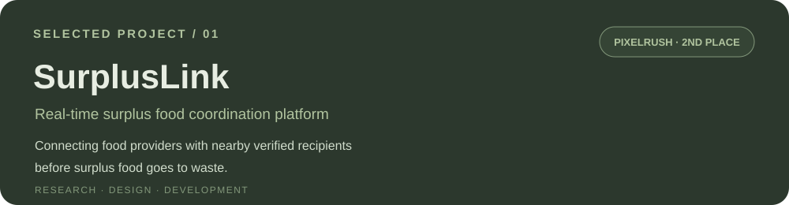

[GitHub](https://github.com/yatra-tank) · [LinkedIn](https://www.linkedin.com/in/yatra-tank-561b42427/) · [LeetCode](https://leetcode.com/u/yatratank/)

---

## 01 / a little about me

---

## 02 / my toolkit

---

## 03 / things I've built

[Repository ↗](https://github.com/yatra-tank/PixelRush-Team_Nankhatai_SU) · [Live demo ↗](https://pixelrush-teamnankhataisu.vercel.app/)

---

## 04 / github corner

**GITHUB OVERVIEW**

*My activity, at a glance.*

 

**CURRENT STREAK / LONGEST STREAK**

---

